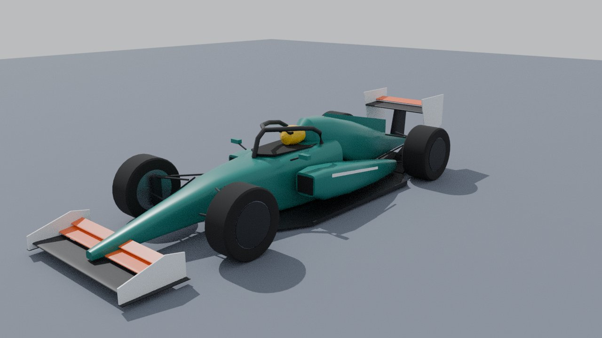
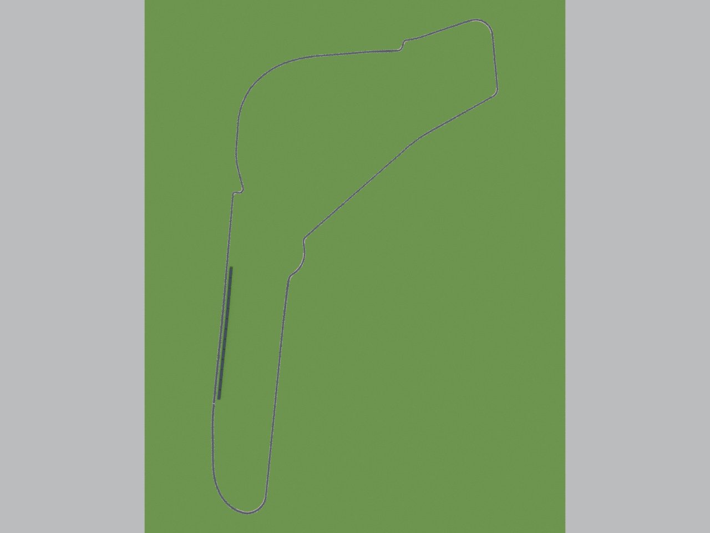

# F1 공력 셋업 랩타임 시뮬레이터 (진행 중)

몬차(고속형)와 모나코(저속형) 서킷에서, 프런트 윙·리어 윙·디퓨저·차고 셋업에 따라 랩타임이 어떻게 바뀌는지 계산하는 시뮬레이터.
**랩타임은 물리 모델로 먼저 계산**하고, 3D 화면은 그 결과를 재생하는 연출이다.

## 현재 상태: 1단계 — 물리 엔진 (화면 없음)

```bash
npm install
npm test      # 단위 테스트 (vitest)
npm run lap   # 몬차 기본 셋업 랩타임 보고서 (명령줄)
```

- 계산 과정 설명: [`docs/physics.md`](docs/physics.md)
- 모든 기본값·가정 목록: [`docs/assumptions.md`](docs/assumptions.md) (`npm run docs:assumptions` 로 자동 생성)
- 서킷 데이터 출처: [`data/tracks/README.md`](data/tracks/README.md)

## 3D 모델 (Blender)

차와 몬차 서킷 모델은 Blender Python 스크립트로 만든다 → [`tools/blender/README.md`](tools/blender/README.md)

| | |
|---|---|
|  |  |

## 데이터

| 파일 | 내용 | 출처 |
|---|---|---|
| `data/tracks/monza_tum.csv` | 몬차 중심선·트랙 폭 | TUM racetrack-database (LGPL-3.0), 원본 OpenStreetMap |
| `data/tracks/monaco.csv` | 모나코 중심선 (트랙 폭 가정값) | bacinger/f1-circuits (MIT) 를 `tools/convert_monaco.py` 로 변환 |
| `data/tracks/*_z.csv` | 서킷 고도 (고저차) | Open Topo Data API (EU-DEM 25 m, SRTM 30 m) — 모나코 터널 구간은 직선 가정 |
| `data/osm/*.json` | 경기장 건물·관중석·피트 레인·도로·나무 (3D 배경) | **© OpenStreetMap contributors**, ODbL 1.0 |
| `data/wing_data.csv` | 윙 받음각별 CL·CD | NeuralFoil 계산값 (역방향 NACA 4412, Re 1.5×10⁶) — **실측 아님, 임시 데이터** |

### 윙 데이터 바꾸기 (데이터과학 프로젝트 CSV)

형식: 머리말 `angle_deg,CL,CD`, 한 줄에 한 받음각. `#` 로 시작하는 줄은 주석(출처 기록용).
CL 은 **다운포스 방향이 +** 인 값으로 읽는다 (부호가 반대면 `parseWingCsv(text, true)` / 화면의 부호 뒤집기 옵션).
받음각 사이 값은 선형 보간, 범위 밖은 끝 값을 쓰고 경고한다.

## 한계

실제 F1 팀·드라이버·스폰서와 무관한 교육용 모델이다. 공력·타이어 값 대부분이 가정값이라
**절대 랩타임은 실제와 다르며**, 셋업 변화의 경향을 보는 도구다. 자세한 한계는 `docs/physics.md` 8장.
